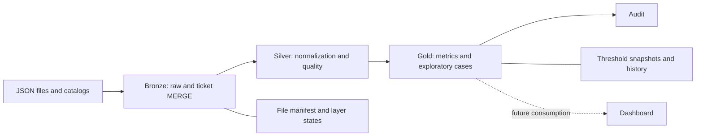

# Architecture

The ticket key is `Id + LocationId + BusinessDate`. Bronze detects new or changed files by path, size and modification time. Corrections replace complete tickets, including arrays. In `upsert_tickets` mode, omitting a ticket from a later file does not delete it.

Silver and Gold rebuild from pinned Delta versions. This removes children absent from corrected tickets and avoids stale aggregates. Ingestion is incremental, followed by batch reconstruction; not every layer performs incremental MERGE.

Each layer records RUNNING before transformation and COMPLETE only after its checks. Downstream tasks require complete inputs and coherent versions. The Job chains Bronze → Silver → Gold → Audit through ALL_SUCCESS. Failure blocks dependent tasks. Explicit `max_retries=0` does not disable default serverless auto-optimization: additional attempts occurred during the duplicate rejection test. Controls must tolerate repetition; failure is final only when the execution terminates.

Delta guarantees atomicity per table. There is no global transaction across tables or distributed lock across Jobs. One writer per environment is required. `max_concurrent_runs=1` protects this Job, not other processes.

Tests create three `applebees_test_<id>_*` schemas and a dedicated volume. They compare the 25 original table versions and dashboard before/after, without reingesting the 11 GB. Original dashboard queries are reference files, not published changes.
