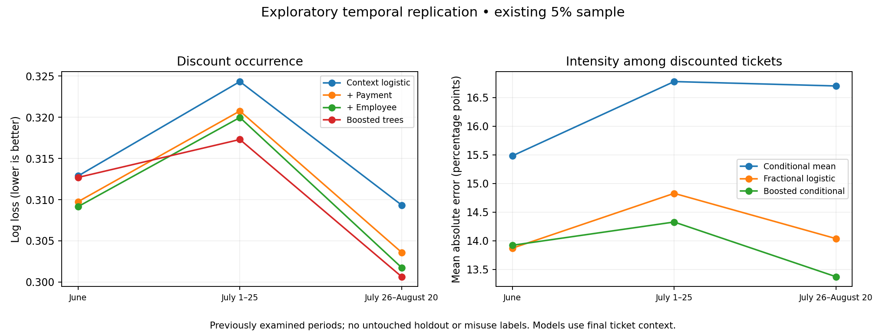

# Deeper analysis: preliminary local evidence

Historical intermediate analysis. The [completed deeper investigation](deep_discount_findings.md) includes subsequent full-data work; earlier authentication/pending-status statements below describe the state at this intermediate stage.


Status: PARTIAL. Remote payment, gratuity, product, policy and full-population employee investigations remain pending authentication. These results do not complete the investigation or select an operational model.

[Protocol and hypothesis register](deep_analysis_protocol.md) | [Aggregate evidence](../evidence/discount_deep_20261027/temporal_models.json) | [Paired diagnostics](../evidence/discount_deep_20261027/model_diagnostics.json)

## What changed in the evidence

The earlier all-ticket Ridge experiment was insufficient to reject intensity modeling. A separate conditional-intensity model improves over a constant conditional mean in all three temporal windows. Its value for actual review decisions remains unmeasured. The all-ticket hurdle gains are small and its absolute error still exceeds a zero prediction because most tickets have no discount.

Trees have no consistent advantage over payment logistic regression. Adding recorded employee identity has small, variable gains and cannot establish abnormal individual behavior. Including identity in an expected-value model may absorb persistent practices one wishes to inspect; models with and without identity answer different questions.



## Population and evaluation

All 103,495 local records are the existing deterministic approximately 5% eligible-ticket sample, not newly extracted full-population data. Each fold uses only preceding dates to fit preprocessing and models; fixed settings were recorded before the new results. Later windows were already inspected in previous work. No new untouched final holdout is claimed.

| Evaluation | Training tickets | Evaluation tickets | Discounted evaluation tickets |
|---|---:|---:|---:|
| June | 32,656 | 26,513 | 2,708 |
| July 1–25 | 59,169 | 22,530 | 2,407 |
| July 26–August 20 | 81,699 | 21,796 | 2,240 |

## Occurrence prediction

Log loss evaluates probability quality; lower is better. All targets are discount occurrence, not justified/unjustified use.

| Evaluation | Context logistic | + Payment | + Employee | Boosted trees |
|---|---:|---:|---:|---:|
| June | 0.31287 | 0.30975 | 0.30915 | 0.31270 |
| July 1–25 | 0.32434 | 0.32076 | 0.31998 | 0.31730 |
| July 26–August 20 | 0.30934 | 0.30359 | 0.30174 | 0.30064 |

Crossed location/date multiplier bootstrap uses 1,500 independent exponential-weight draws and holds models fixed. It is a dependence sensitivity analysis, not a full training-refit or future-period uncertainty interval. Location-only and date-only bootstrap results are also saved. These exploratory intervals are not multiplicity-adjusted hypothesis tests.

| Evaluation | Payment loss gain vs context (95% interval) | Trees loss gain vs payment (95% interval) |
|---|---|---|
| June | 0.00313 [0.00137, 0.00511] | -0.00295 [-0.00682, 0.00083] |
| July 1–25 | 0.00357 [0.00138, 0.00594] | 0.00346 [0.00017, 0.00687] |
| July 26–August 20 | 0.00575 [0.00358, 0.00821] | 0.00295 [-0.00024, 0.00611] |

## Conditional positive intensity

Models fit only positive-discount tickets. Fractional logistic minimizes a regularized fractional Bernoulli objective using paired binary records with weights y and 1-y; an independent direct numerical objective check agreed within 0.00000003 in coefficients. Ratios are bounded; no observed sample ratios exceeded one. Targets describe final ticket discounts, not eligibility or authorization.

| Evaluation | Mean baseline MAE (pp) | Fractional MAE (pp) | Boosted MAE (pp) |
|---|---:|---:|---:|
| June | 15.48 | 13.87 | 13.92 |
| July 1–25 | 16.78 | 14.83 | 14.33 |
| July 26–August 20 | 16.70 | 14.04 | 13.37 |

Conditional fractional squared-error improvements over the mean baseline have positive location/date crossed intervals in all windows. Calibration still shifts: in July 1–25 the observed conditional mean is 26.24%, versus 22.58% predicted. A useful average loss gain does not guarantee accurate individual case estimates.

## Variable map and interpretation

| Variable group | Evidence so far | Limitation |
|---|---|---|
| Channel | Largest unrestricted group permutation loss increase in all three windows | Permutation creates unrealistic channel/payment combinations; not a causal ranking |
| Payment family | Incremental loss gain in all windows | Three-category legacy encoding; mixed payments collapsed; within-employee full-data work pending |
| Gross, lines and traffic jointly | Predictive contribution in both model families | Final ticket context; correlated predictors; no detailed products |
| Location | Predictive contribution, larger in trees | Geography may proxy unmeasured promotion and operational mix |
| Hour and weekday | Smaller loss changes | Does not rule out specific interactions or rare periods |
| Recorded employee identity | Small gains; crossed interval includes zero in first two windows | Does not validate employee anomaly flags or authorization roles |
| Recorded gratuity | Not present in local extracts | Cannot yet estimate its association or rank its importance |
| Discount type and manager | Not predictors in these experiments | Retrospective composition and opportunity analysis still required |

Group permutation uses five repeats; repetition ranges are Monte Carlo variability, not statistical confidence intervals. Correlated features can mask or exaggerate apparent importance. Consult the official [scikit-learn correlated-features example](https://scikit-learn.org/stable/auto_examples/inspection/plot_permutation_importance_multicollinear.html). No percentage of causal contribution is assigned.

## Hypothesis status and practical implications

H3 receives exploratory support: separating frequency from positive intensity merits continued investigation. H4 is mixed: nonlinearity helps in some windows, but its advantage is unstable. H1 remains unresolved at the requested within-employee/product level, despite consistent sample predictive contribution from payment. H2, H5, H6 and H7 remain unresolved. No employee is identified as a policy violator.

An explainable two-part expected-discount profile is now a credible option to investigate alongside policy review and context monitoring. This is not a recommendation to deploy or choose it; review yield, business policy compatibility, support coverage and fresh confirmation are still missing. No discount amount is labeled recoverable loss.

## Reproduce

```sh
python3 tools/deep_temporal_models.py ../output/discount_solution ../output/discount_deep_20261027
python3 tools/deep_model_diagnostics.py ../output/discount_deep_20261027
python3 tools/deep_report_local.py ../output/discount_deep_20261027
```

Input hashes and source Delta versions are recorded in aggregate evidence. Private prediction files remain outside the release. Three pinned SQL requests have been prepared but not executed: recording audit, within-employee cash/card and gratuity denominators. Their runtime schemas must be verified on execution. No remote resource was modified. The existing release ZIP is preserved and does not contain this new work.
