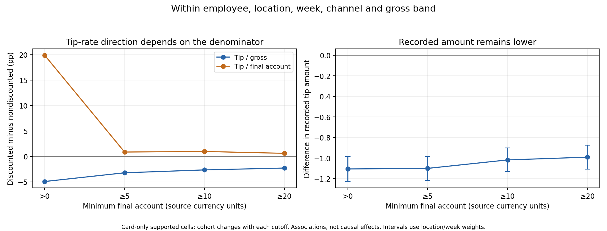

# Discount-control investigation: findings and solution options

This investigation reopens the earlier recommendation rather than treating it as a selected solution. It combines full-snapshot descriptive comparisons, temporal models on a verified sample, partially reserved record-level replication and contextual case review. No production resource was changed, no final model was selected and no misuse label was inferred from statistical differences.

## What the evidence now supports

1. Cash remains associated with more discounts after substantially richer adjustment. In supported full-data cells sharing employee, location, week, channel, gross band, daypart and line-count band, cash frequency is 18.04% versus 9.65% for card: +8.40 percentage points. The comparison covers 608,926 of 1,709,808 eligible attributable pure-payment tickets (35.61%), not all sales. A separate product/employee-adjusted sample model estimates +7.55 points, with a location/week refit interval of +6.25 to +8.95. Neither result identifies a causal cash effect or improper use.
2. Tip percentages can point in the opposite direction from recorded tip amounts because discounts reduce the denominator. Within supported employee/location/week/channel/gross-band comparisons, discounted card tickets have lower recorded tip amounts and lower gross-based tip rates. Their final-account tip rate can nevertheless be higher. Tiny final accounts amplify that contrast dramatically.
3. Conditional intensity deserves renewed consideration. A fractional model trained only on positive-discount tickets improves over a conditional mean in three temporal windows and a separate record partition. The earlier all-ticket Ridge result did not justify dismissing intensity models generally.
4. Product context and detailed payment groups add predictive information. Recorded gratuities add a smaller retrospective gain. These variables describe the completed transaction; they are not automatically available at authorization time.
5. Some employee differences persist, but the evidence does not validate the earlier exploratory bands as statistical misconduct alerts. Shrinkage changes how many profiles appear extreme; a conservative multiplicity diagnostic yields no discoveries.
6. Policy mapping and item scope matter as much as statistical modeling. All ten inspected examples selected deterministically from EMP50 co-occurrence candidates applied the different discount types to different item lines. They remain candidates under an unresolved ticket-wide policy, not established overlapping-line violations.

## Data, targets and recording audit

The pinned full snapshot contains 2,142,846 tickets across 127 locations and 115 dates, April 28-August 20, 2026. The recording audit preserved all composite ticket keys and counts. There were zero occurrence-definition mismatches, discount-sum mismatches, negative discount amounts, null discount amounts, null payment amounts or null gratuity fields among existing payment records. Absence of a payment record remains distinct from a recorded zero.

There are three tickets with positive gratuity signs, in the no-products cohort; they are not silently treated as ordinary positive sales. Two discount percentages exceed 100% in nonpositive cash accounts. These cases are retained in the full audit and excluded from the positive-account models. The audit counts 55,883 tickets at or above 99.99% discount, rather than treating all of them as ordinary paid sales. Refund/reversal semantics remain unresolved; negative payment records are separated, not labeled refunds automatically.

All 486,509 CASH payment records contain zero recorded gratuity. This is recording behavior, not proof that customers paid no cash tips. Mixed and platform payments have different recording coverage. The confirmed POS sign convention is preserved: interpreted tip is minus recorded Gratuity when signs and completeness permit it.

The occurrence target is any positive discount application. The intensity target is recorded discount/gross on valid accounts; the audit found no positive-event tickets with nonpositive net discount. Policy compatibility is a third, separate question, requiring eligibility, mapping, scope and exception evidence.

Source-schema inspection found item OrderTime and ticket open/close times, but no discount timestamp or payment timestamp. The final basket cannot establish what was known when an authorization decision occurred. All current models are retrospective. The source currency is not inferred; monetary figures below use source currency units.

## Cash, card and mixed payments

The stricter full-data matched comparison uses a minimum of two tickets per method in each cell. Its frequency difference is +8.40 points, with an approximate crossed location/week interval of +7.25 to +9.59 points. Mean ticket-level intensity differs by +2.25 points, interval +1.94 to +2.60. This mean of ticket ratios is not the ratio-of-sums intensity used in the earlier cash/card report.

| Minimum tickets per method/cell | Comparable tickets | Eligible coverage | Cash frequency | Card frequency |
|---|---:|---:|---:|---:|
| 2 | 608,926 | 35.61% | 18.04% | 9.65% |
| 5 | 120,212 | 7.03% | 18.54% | 9.49% |
| 10 | 7,422 | 0.43% | 20.23% | 9.27% |

Increasing minimum support changes the population drastically. The lowest-coverage result must not be extrapolated to the chain. The earlier sample-only threshold reversal was a sparse-support result, not a general reversal; see [sample support analysis](deep_payment_support.md).

| Recorded payment family | Positive reconciled tickets | Discount frequency | Tickets with positive recorded tip |
|---|---:|---:|---:|
| Cash only | 381,970 | 17.21% | 0 |
| Card only | 1,327,880 | 9.72% | 981,571 |
| Other only | 294,540 | 2.55% | 20,821 |
| Cash + card | 10,609 | 16.47% | 4,263 |
| Card + other | 31,740 | 12.22% | 22,168 |
| Cash + other | 16,303 | 15.19% | 115 |
| Cash + card + other | 351 | 19.94% | 178 |

These are unadjusted family descriptions. Families reflect recorded payment-line presence; a zero CASH record is not proof of cash collection. The existing positive-payment-only sensitivity remains relevant. Four OLO card labels have IsCreditCard=false; they remain an explicit mapping limitation. Mixed tickets must not inherit either cash-only or card-only tip assumptions.

The observed matched frequency gap corresponds to about 84 additional discounted tickets per 1,000 tickets in that supported comparison. This is a scale description, not a forecast of preventable cases or recovered money.

## Recorded gratuities: amount versus denominator

The card-only matched study holds employee, location, week, channel and gross band constant, requiring at least two discounted and two nondiscounted tickets per cell. It does not fully balance every product or promotion within those cells. Positive-account eligibility and filtering can select the comparison population.

| Minimum final account | Matched tickets | Coverage of that eligible cohort | Discounted minus nondiscounted tip amount | Difference in tip/gross | Difference in tip/final account |
|---|---:|---:|---:|---:|---:|
| Greater than 0 | 414,344 | 31.20% | -1.107 | -4.93 pp | +19.88 pp |
| At least 5 | 408,446 | 31.02% | -1.101 | -3.22 pp | +0.86 pp |
| At least 10 | 387,307 | 30.30% | -1.019 | -2.65 pp | +0.97 pp |
| At least 20 | 324,372 | 28.95% | -0.992 | -2.28 pp | +0.61 pp |

For the account-at-least-5 comparison, crossed location/week intervals are -1.219 to -0.986 for amount, -3.65 to -2.82 points for tip/gross, and +0.32 to +1.38 points for tip/final-account. These intervals condition on the observed matched cells and only 17 weeks. They are not causal or familywise-adjusted significance claims.

Excluding tickets with positive provisional EMP50 IDs (518, 520, 523) leaves 368,008 matched tickets at account >=5. The differences remain -0.972 in amount, -2.46 points on gross and +1.20 points on final account. This changes the cohort; it is not a causal decomposition of employee promotions.

Composition still matters. Among card-comparable tickets with accounts >=5, EMP 50 (520) has 8,996 zero recorded tips among 12,630 tickets (71.23%). MILTARY 10 has 5,261 among 20,442 (25.74%). These overlapping type-level groups are unadjusted and cannot be added or interpreted as promotion effects. Eligibility and service context may differ.

A monitoring design should display recorded tip amount, gross-based rate, final-account rate, denominator and payment recording coverage together. A high final-account tip percentage alone is a poor basis for escalation.

## Models, variable map and replication

The existing deterministic residue-0 sample contains 103,495 eligible tickets. The three expanding temporal fits use 32,656, 59,169 and 81,699 training tickets, respectively. Enrichment preserved every sampled key and target value. No model was fitted to millions of tickets.

| Variable/group | Direction or predictive finding | Stability and limits |
|---|---|---|
| Cash versus card | Higher expected discount occurrence in supported comparisons | Persists after regularized employee/product context; association, not causal payment effect |
| Channel | Largest legacy group-permutation loss change | Correlated with payment and basket; unrestricted permutation can create unrealistic combinations |
| Product category, category diversity and detailed payment | Improve occurrence prediction jointly | Positive gain in all three windows and partially reserved replication; joint gain does not isolate a single product effect |
| Gross, line count and traffic | Useful contextual information | Correlated final-ticket variables; no authorization-time availability established |
| Hour and weekday | Smaller legacy permutation contribution | Specific interactions may still matter; no causal ranking |
| Recorded gratuity amount/zero indicator | Small added retrospective predictive contribution | May follow the discount; no interpretation as a cause or authorization predictor |
| Employee identity | Small incremental prediction gains | Can absorb persistent practices; use a separate employee-free expected-value benchmark for monitoring |
| Manager ID | Describes discount-record associations | No complete manager opportunity or verified authorization-role data |
| Discount types and amounts | Targets, policy and explanatory composition | Excluded from occurrence predictors to avoid outcome leakage |

Payment model contrasts with product and employee context estimate +7.55 points on 15,166 supported late-period tickets. A 150-refit crossed location/week multiplier bootstrap gives +6.25 to +8.95 points. It holds preprocessing and the evaluation population fixed, retains regularization and uses only 13 training weeks. It does not eliminate unmeasured confounding.

After locking specifications, 21,483 late-period tickets from hash residue 19 were extracted. They do not overlap the model sample and were not used for fitting or tuning. They did appear in earlier full-population aggregates, so this is partially reserved record-level replication, not a pristine final holdout.

| Model | Replication log loss (lower is better) |
|---|---:|
| Context logistic | 0.31142 |
| Add legacy payment family | 0.30840 |
| Add product context and detailed payment groups | 0.30249 |
| Add employee identity | 0.30100 |
| Add retrospective recorded gratuity | 0.29943 |
| Fixed shallow boosted model with legacy payment | 0.30530 |

The product/detailed-payment gain over legacy payment is 0.00592 (crossed location/date interval 0.00366-0.00809). The tip gain over product/employee is smaller, 0.00157 (0.00003-0.00319), and should not be overstated after adaptive exploration and multiple comparisons. Trees improve in this replication but did not outperform logistic consistently across the earlier windows. No winner is selected.

On replication tickets with positive discounts, conditional fractional intensity MAE is 13.70 percentage points versus 16.56 for the conditional mean; RMSE is 17.25 versus 19.59 points. The mean prediction is 23.77% versus 23.99% observed. This supports a two-part frequency/severity investigation. It does not demonstrate precise individual predictions, review utility or misuse detection. All-ticket hurdle gains remain small and zero predictions can win on MAE because most tickets have no discount.

### Exploratory interaction sensitivity

A subsequent, explicitly exploratory check adds channel-by-payment and tip-by-card/In-Store interactions, and compares shallow boosted trees using products, detailed payment and recorded tips (without employee identity). Explicit logistic interactions yield small log-loss gains: 0.00086, 0.00117 and 0.00041 across the three windows; the last interval crosses zero. Enriched trees have a negative June gain (-0.00151), then positive July and late-period gains (+0.00569 and +0.00735). Late-period AUC rises from 0.731 for the additive model to 0.748. This strengthens the case for studying context-specific retrospective patterns, while retaining the temporal-stability caveat. It was conducted after initial replication results and is not relabeled as confirmed on residue 19. See [interaction evidence](../evidence/discount_deep_20261027/interaction_results.json).

## Employee, manager, repetitions and void context

Existing peer cells compare employees with other employees at the same location/channel/payment/week. Support remains 1,001,265 of 2,062,794 eligible attributable tickets (48.54%). Complete-week persistence analysis excludes the initial/final partial weeks and the week crossing the selection cutoff.

Of 435 profiles with at least eight early weeks/500 tickets and two later weeks/100 tickets, five exceed +10 points early; four remain above +10 later and all five remain positive. Shrinking toward peer expectations with 100 equivalent tickets leaves four initial candidates; with 500 it leaves one. These are transparent sensitivity strengths, not fitted empirical-Bayes parameters. Early/later rank correlation is 0.515.

A one-sided weekly sign diagnostic across 534 sufficiently supported early profiles gives 41 raw p-values below .05 but zero discoveries after Benjamini-Yekutieli correction. Weekly independence is unverified: this diagnostic is not a calibrated alert test, and the correction does not solve within-profile serial dependence. The earlier bands are descriptive review cues, not statistically confirmed employee anomalies.

Among 2,241 employee/location profiles with at least 30 positive discount events, four assign at least 90% of those events to one recorded manager pair. There are 595 events with equal employee and manager IDs. The same person appearing in both fields does not establish self-authorization. Non-discount tickets do not provide manager opportunities, so concentration cannot be interpreted as excess authorization propensity.

Repeated amounts often reflect ordinary promotion structure: KIDS FREE has 65.96% of its positive events at 7.49, and BIRTHDAY has 88.82% at 1.99. The [sample percentage-pattern evidence](../evidence/discount_deep_20261027/percentage_patterns.json) retains rounded percentages and dominant product categories. Repetition alone is not a useful misconduct label.

The full item-line investigation also shows why repeated products and percentages need type-specific interpretation. TASTE has a rounded 100% line ratio in all 24,326 positive events with valid line gross. For item EMP 50% (523), the top product accounts for only 96 of 1,497 events; among 1,478 events with positive line gross, 52.98% round to a 50% event/line-gross ratio. Nineteen lack a positive line denominator. A label is not a validated percentage rule: application scope, line accounting and repeated applications need reconciliation before classifying deviations. See [product and line-percentage evidence](../evidence/discount_deep_20261027/product_patterns.json).

Positive card tickets with discounts have voids in 4,926/129,070 cases (3.82%), versus 24,391/1,198,810 without discounts (2.03%). Cash figures are 4.12% versus 2.37%. These unadjusted co-occurrences can reflect service recovery; voids are an investigation context, not proof of abuse or a causal precursor.

Further clustering was not forced: existing clustering has not demonstrated better support or decision utility than explicit contexts. New segmentation should earn its place by improving coverage and review outcomes, not merely silhouette scores.

## Private practical case review

Ten deterministic EMP50 co-occurrence examples were traced back to positive discount events. All ten combined different item-level discount types on different lines. Examples include EMP 50% with EMP 10%, Pride or Birthday. Their ticket/event keys and exact amounts remain only in `output/discount_deep_20261027/private_case_review.json`.

A reviewer would need the business rule's ticket-wide versus same-line scope, confirmed label mapping, eligibility and exception evidence. A candidate can be policy-compatible at line level while still requiring review under a ticket-wide rule. These ten examples are not a random sample and do not estimate the prevalence of justified candidates. No case was resolved as a confirmed breach.

## Evidence-backed options for discussion

| Option | What it would do | Evidence and benefit | Tradeoff and human-review requirement |
|---|---|---|---|
| Policy and evidence review | Version mappings and scope; retain event/line evidence; collect reviewer reasons and corrections | Different-line examples show why raw co-occurrence is insufficient | Business must resolve mappings, exceptions and eligibility; candidates remain unresolved until reviewed |
| Two-part contextual monitoring | Estimate expected occurrence and conditional severity separately; surface persistent deviations with support and uncertainty | Cash/context associations and conditional-intensity gains replicate | Predictions concern discounts, not misuse; low-volume shrinkage and review-capacity validation are required |
| Retrospective payment/tip diagnostics | Show amount and both tip denominators, payment completeness, promotion mix and void context | Strong denominator sensitivity and smaller residual tip association | Post-transaction tool; zero cash tips and high final-account percentages cannot trigger sanctions |

These options can complement one another. The evidence supports evaluating them, not deploying or selecting a final model now. A policy-first pilot is operationally explainable; adding contextual estimates may improve triage, while a retrospective tip view can prevent misleading interpretations.

Before choosing, run a reviewer pilot that samples both prioritized and randomly selected non-alerted cases, stratified by location/payment/support. Record policy version, decision, reason, missing evidence, review time and corrections. Estimate confirmed-breach and justified-case shares with sampling weights and uncertainty, as well as unresolved share and review workload. Reviewers should not treat model scores as evidence of guilt. Compare options at the same review budget. None of these business outcomes has yet been measured; no savings or recoverable loss is claimed.

## Hypothesis outcomes and unresolved evidence

| Hypothesis | Outcome |
|---|---|
| H1: Cash association survives richer context | Supported observationally on supported populations; causal meaning and complete coverage unresolved |
| H2: Tip association survives denominator/context checks | Lower recorded amounts and gross-based rates persist; final-account percentage is highly denominator-sensitive; causality unresolved |
| H3: Conditional intensity improves over a constant | Supported in temporal windows and partially reserved replication; operational value unresolved |
| H4: Nonlinearity clearly dominates | Not supported consistently; gains depend on period and specification |
| H5: Employee differences persist and justify anomaly labels | Some descriptive persistence; no multiplicity-supported flags in the diagnostic; misuse interpretation unsupported |
| H6: Manager concentration identifies excess authorization | Unresolved because actual authorization roles and opportunity denominators are absent |
| H7: Clustering improves review decisions | Not demonstrated; not selected merely for methodological variety |

Fresh later-period data, authorization-time snapshots and human decisions remain necessary for prospective validation. These are substantive data limits, not results to fill with assumptions.

## Reproduction and protection

See [reproduction commands](deep_reproduction.md), [protocol](deep_analysis_protocol.md), and [execution manifest](../evidence/discount_deep_20261027/execution_manifest.json). All remote operations were SELECT/CTE queries over pinned sandbox sources. No table, Job, notebook or dashboard write was performed. This statement does not audit unrelated changes by other actors. Original data was not reingested. The existing release ZIP remains unchanged; new scripts, documents and aggregate evidence are in the canonical source tree.

The initial authentication diagnosis was corrected: sandbox CLI checks returned missing credentials, while expanded-access CLI verified the configured identity. A sandbox failure alone must not be described as an expired user session.
