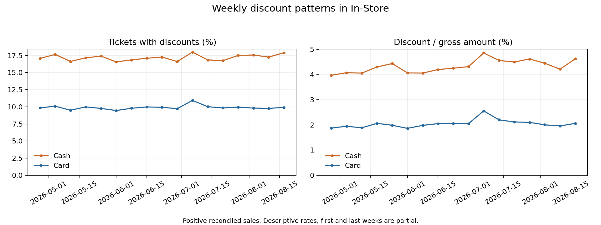

# Discount control preparation and solution options

Update: the [deeper investigation findings and options](deep_discount_findings.md) now include completed remote analyses and replication. Earlier recommendations and pending-status notes below are retained as historical context; no final operational model has been selected.

The challenge calls for verifiable policies, comparison of similar operations and human review. Evidence favors rules and contextual monitoring, with regularized logistic regression supporting estimates of expected discount frequency. Ridge intensity regression and exploratory clustering offer weaker evidence as the primary component.

Final selection and implementation remain pending. No automatic blocking, sanctions, fraud classification or new production dashboard has been deployed.

## Prepared base

Original tables remain in `workspace.applebees_bronze`, `workspace.applebees_silver` and `workspace.applebees_gold`. Analysis reads pinned Delta versions from `applebees_test_0eef22876f8b`; it does not reingest original files.

The new base is `workspace.applebees_test_fdab42c8d6ad_discount_review`. Its [run](https://dbc-16eae557-a41d.cloud.databricks.com/?o=7474660351820655#job/616385588145573/run/608560147970208) succeeded. See [validation](../evidence/discount_review/base_validation.json).

| Table | Rows | Purpose |
|---|---:|---|
| ticket_features | 2,142,846 | Complete tickets, variables, quality, eligibility and temporal split |
| discount_events | 516,690 | Ticket/item discounts, event keys and provisional policy mappings |
| policy_review_candidates | 2,312 | EMP50 events coexisting with another positive discount type |
| employee_weekly | 172,826 | Frequency, amount and denominators by employee, location, channel, payment and week |
| review_decision_log | 0 | Empty structure for future human decisions and correction history |

All tables are Delta version 0. The 2,312 event-level candidates involve 2,135 distinct tickets; multiple applications can share one ticket. Detail remains in the workspace. The release exports aggregates, not ticket samples or individual employee profile identifiers.

Model eligibility requires positive reconciled accounts, valid denominators and no negative payments. Zero accounts and quality exceptions remain in the complete base and rule analysis. Participation in payments/discounts does not prove authorization responsibility.

## Discount evolution

In-Store weekly positive-account discount frequency ranges from 16.57% to 18.00% for cash and 9.46% to 10.94% for card. Both peak in the week of July 6. Discount/gross intensity also peaks that week: 4.86% cash and 2.56% card. These are descriptive rates without adjustment for changing location/promotion mix. First and last weeks are partial.

The earlier comparison within location, channel and date found standardized frequency of 17.26% cash versus 9.93% card, predominantly representing In-Store. See [cash/card results](efectivo_tarjeta_resultados.md).

## Employee attribution and contextual comparison

All positive employee and manager IDs on discount records match the catalog. Many catalog entries are marked Deleted; current deletion status does not establish invalid historical activity. They remain in the analysis.

For 345,499 positive discount events, discount EmployeeId equals the uniquely attributable payment employee. Another 4,808 events lack unique payment attribution. There are no differing IDs among attributable events. This describes recorded fields, not independent operational actions or authority.

Peers share location, channel, payment family and week, excluding the employee's own records. Each cell requires 30 employee tickets and 100 peer tickets. Of 2,062,794 eligible attributed tickets, 1,001,265 meet this support requirement, about 48.54%. Results do not automatically generalize to excluded activity.

There are 1,436 employee–location profiles with at least four comparable weeks and 200 tickets. Fifteen exceed peer-expected discount frequency by more than 10 percentage points; 772 fall within ±2 points. These exploratory bands are neither validated compliance thresholds nor significance tests. Near-peer frequency does not prove legitimate use on individual tickets.

Across consecutive complete weeks, 204 increases above 15 points in the employee-versus-peer gap involve 186 employees and 91 locations. These signals can overlap with the 15 profiles and must not be summed as independent cases. Discount mix among flagged profiles includes LRM10%, MANAGER, EMP50, TASTE and KIDS FREE. Explain promotions and operational roles before attributing misconduct. This mix covers their full-period activity, not only flagged cells.

## Incompatibility rules

The business clarification states that Employee Meal and Employee Fifty must not combine with other discounts. Observed IDs and scopes remain separate:

| ID | Label | Scope | Tickets with positive application | With another positive type |
|---|---|---|---:|---:|
| 520 | EMP 50 | Ticket | 27,865 | 2,029 |
| 518 | EMP 50% | Ticket | 273 | 21 |
| 523 | EMP 50% | Item | 1,051 | 85 |
| 65 | MIT MEAL | Ticket | 581 | 54 |

Groups may overlap. Zero-amount records do not activate the rule. Repeated applications of one ID differ from combining different types. Item-level analysis retains whether applications overlap on the same line; different-line combinations are not automatically incompatible. See [pairs](../evidence/discount_review/combinations.json).

MIT MEAL is not confirmed as Employee Meal. Equivalence of the three EMP50 IDs is also unconfirmed. Exact mapping, ticket/item scope and exceptions require versioned business policy. The [provisional registry](../configs/review_policy_candidates.json) records confirmed statements, unresolved questions and exploratory parameters. Until these are resolved, cases remain candidates requiring mapping/scope confirmation.

## Exploratory model comparison

A deterministic approximately 5% sample preserves target prevalence: 103,495 tickets. Training spans April 28–June 30 (59,169 tickets), validation July 1–25 (22,530), and test July 26–August 20 (21,796). Transformations fit only training data; validation selects parameters; test does not retune them.

Predictors include location, channel, opening hour, weekday, traffic, gross amount and line count. A retrospective variant adds payment family. Employee identity, discount type/amount, net sales, manager and gratuity are excluded predictors. Gross amount and lines describe the final ticket: real-time authorization would require reconstructing information available at decision time. Positive-account selection also defines a retrospective population.

| Approach | Test result | Interpretation |
|---|---|---|
| Training-prevalence constant | AUC 0.500; log loss 0.3312 | Minimum reference |
| Regularized logistic without payment | AUC 0.671; log loss 0.3096 | Context contributes information |
| Regularized logistic with payment | AUC 0.702; log loss 0.3033; average precision 0.203 versus prevalence 0.103 | Estimates discount frequency, not abuse probability |
| Ridge for discount/gross | RMSE 0.09555 versus mean baseline 0.09726; MAE 0.04127 versus zero baseline 0.02477 | Small squared-error gain; loses on absolute error to zero prediction |
| Context K-means | Two groups; validation silhouette 0.274 | Moderate segmentation, not good/bad-use classes |

Logistic weekly test AUC ranges from 0.695 to 0.719. Calibration is reasonable at low probabilities but underestimates the 20–40% band; the highest band contains only 15 cases. Brier improvement over prevalence is 0.00453, with an approximate date-bootstrap interval of 0.00401–0.00505. Only 26 dates are represented; this does not capture all cross-location dependence or future-period uncertainty.

On discounted test tickets, Ridge predicts mean intensity of about 3.07% versus observed 24.11%, making it unsuitable as the sole review engine. An illustrative validation-99th-percentile residual cutoff selects 157 test tickets. Their discount amount is not recoverable loss or confirmed abuse.

Clustering uses employee–location context profiles with at least 20 sampled tickets per period; only 249 profiles qualify in test. Inputs are payment/channel mix, weekend share, amount and line count, without discount outcomes. It may describe comparable groups but excludes small profiles and has not demonstrated improved review prioritization.

Metrics concern discount prediction, not violation-detection precision. Measuring that precision requires human-reviewed samples including non-alerted cases. See scikit-learn guidance on [data leakage](https://scikit-learn.org/stable/common_pitfalls.html) and [clustering evaluation](https://scikit-learn.org/stable/modules/clustering.html).

## Solution options

| Option | Components | Strength | Limitation |
|---|---|---|---|
| Rules and contextual review | Versioned policies, combinations, comparable rates, temporal alerts and review history | Explainable and directly connected to operations | Mapping and reviewer-validated thresholds required |
| Rules plus regularized logistic regression | Above plus expected frequency and employee-level deviations | Favorable temporal evidence for contextual adjustment | Predicts discounts, not abuse; requires calibration and utility evaluation |
| Rules plus segmentation | Context clusters to organize peer comparisons | Describes different operational patterns | Moderate separation and low small-profile coverage |

The recommended option for discussion is rules plus contextual review supported by logistic regression. Rules-only contextual review is a simpler initial alternative. Neither Ridge nor clusters should automatically label good/bad use.

Final selection should consider review capacity, justified-case share, confirmed-policy-breach share, stability by location/employee and resolution time. These operational outcomes have not yet been measured with human reviewers.

## Case follow-up

Each candidate retains ticket/event keys, discount type/scope, recorded employee/manager, rule/version, amount, context and evidence snapshot. Initial status is candidate. Allowed decisions are JUSTIFIED, CONFIRMED_POLICY_BREACH, DATA_ISSUE and INSUFFICIENT_EVIDENCE. Reviews require identity, timestamp, reason, justification, policy version and evidence. Corrections append a linked event rather than erase history.

The log is empty; no reviewers or notifications are assigned. Policy-compatible use requires eligibility evidence and documented resolution. Low frequency, statistical normality or cluster membership alone is insufficient.

## Validation

The five-table base preserved all protected original and source versions and the dashboard. An [independent query](../evidence/discount_review/base_independent.json) found no missing/changed tickets, missing/extra cases or weekly total differences. The destination guard passed local tests; the new synthetic Job 372187525837578 passed all five scenarios, including recovery. Documentation-only cleanup is tracked separately from that executable validation.

Evidence: [roles](../evidence/discount_review/roles.json), [context](../evidence/discount_review/employee_context.json), [weekly evolution](../evidence/discount_review/weekly.json), [employee dynamics](../evidence/discount_review/employee_dynamics.json), [models](../evidence/discount_review/model_comparison.json), [diagnostics](../evidence/discount_review/model_diagnostics.json).
