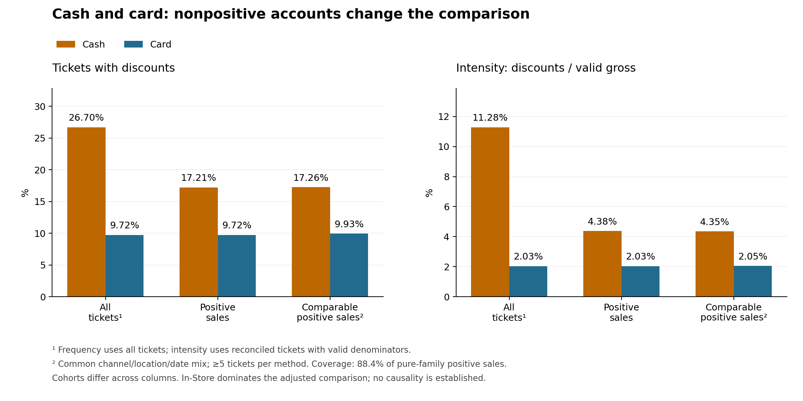

# Discounts in cash and card transactions

In comparable positive sales, standardized discount frequency is 17.26% for cash and 9.93% for card, a 7.33 percentage-point difference. The association persists within channel, location and date, predominantly representing In-Store. It does not establish causality or abuse.

## Raw comparison mixes different operations

| Measure | Cash | Card | Cash − card difference |
|---|---:|---:|---:|
| Frequency, all tickets | 26.70% | 9.72% | 16.98 pp |
| Frequency, positive sales | 17.21% | 9.72% | 7.49 pp |
| Frequency, standardized positive sales | 17.26% | 9.93% | 7.33 pp |
| Intensity, positive sales | 4.38% | 2.03% | 2.35 pp |
| Intensity, standardized positive sales | 4.35% | 2.05% | 2.30 pp |

The cash-only family contains 65,116 reconciled nonpositive accounts, 55,839 with positive discount applications. It also contains 73,438 tickets with some zero payment and no positive payment. A zero-amount CASH label does not establish a cash collection. These remain in the complete description and are separated from positive sales.

The positive cohort contains 381,970 cash and 1,327,880 card tickets. Valid intensity denominators cover 381,954 and 1,327,880 respectively; discount and gross sums use those same tickets.

## Context and coverage

Requiring five tickets per method in each channel/location/date cell gives 15,153 cells and 1,512,337 tickets, 88.45% of eligible pure-family positive tickets. Cash coverage is 93.26%; card coverage is 87.06%.

| Channel | Comparable tickets | Coverage of positive pure-family sales | Cash frequency | Card frequency | Difference |
|---|---:|---:|---:|---:|---:|
| In-Store | 1,501,799 | 99.89% | 17.28% | 9.92% | +7.36 pp |
| To Go | 10,339 | 13.29% | 14.51% | 12.45% | +2.06 pp |
| Online AS | 0 | 0.00% | — | — | No common support |
| Online | 199 | 0.16% | 3.22% | 6.10% | -2.88 pp |
| Delivery Service | 0 | 0.00% | — | — | No common support |
| Catering | 0 | 0.00% | — | — | No common support |
| Door Dash | 0 | Not applicable | — | — | No common support |
| Uber Eats | 0 | Not applicable | — | — | No common support |
| BITESQUAD | 0 | Not applicable | — | — | No common support |
| DELIVERLOGIC | 0 | Not applicable | — | — | No common support |
| WOTW | 0 | Not applicable | — | — | No common support |
| GRUBHUB | 0 | Not applicable | — | — | No common support |
| POSTMATES | 0 | Not applicable | — | — | No common support |
| Olo - Mastercard | 0 | Not applicable | — | — | No common support |
| Olo - Visa | 0 | Not applicable | — | — | No common support |
| Olo - Discover | 0 | Not applicable | — | — | No common support |
| Olo - Amex | 0 | Not applicable | — | — | No common support |

In-Store contributes 99.30% of comparison weight. To Go has limited coverage. Online has only 199 comparable tickets (45 cash and 154 card), so its result cannot represent all Online sales. Channels without common support are reported without artificial pooling or imputation.

## Sensitivity checks

| Scenario | Adjusted cash frequency | Card | Difference |
|---|---:|---:|---:|
| Primary, minimum 5 | 17.26% | 9.93% | 7.33 pp |
| Positive payment records only | 17.26% | 9.93% | 7.33 pp |
| Include four OLO card labels | 17.26% | 9.93% | 7.33 pp |
| Positive payments + OLO labels | 17.26% | 9.93% | 7.33 pp |
| Exclude tickets with EMP 50 / EMP 50% | 14.58% | 8.97% | 5.60 pp |
| Exclude tickets with EMP labels | 13.54% | 8.43% | 5.12 pp |
| Minimum 1 per method/cell | 17.25% | 10.01% | 7.24 pp |
| Minimum 20 per method/cell | 16.86% | 9.76% | 7.10 pp |
| No discrepant/unassessable lines | 17.26% | 9.93% | 7.33 pp |

EMP exclusions change the population, not a causal decomposition. Observed labels do not establish complete employee-promotion mapping or compliance with incompatibility rules. OLO sensitivity changes do not enter common-support cells in this snapshot. Positive-payment-only classification adds 15 card tickets to the main comparison with negligible rate changes.

## Discount types

| Label / scope | Cash tickets | % of positive cash sales | Card tickets | % of positive card sales |
|---|---:|---:|---:|---:|
| EMP 50 (ticket, ID 520) | 12,793 | 3.35% | 14,506 | 1.09% |
| LRM10% (ticket, ID 146) | 10,251 | 2.68% | 14,362 | 1.08% |
| MILTARY 10 (ticket, ID 93) | 9,420 | 2.47% | 20,457 | 1.54% |
| TASTE (item, ID 19) | 3,561 | 0.93% | 9,187 | 0.69% |
| PUNCHHOLO (ticket, ID 170) | 124 | 0.03% | 7,731 | 0.58% |

Counts are distinct within each type but types can coexist; columns must not be summed as exclusive groups. This table is descriptive without contextual adjustment. EMP 50, LRM10% and MILTARY 10 occur relatively more often in cash sales. That motivates review of promotion mix and operations, not a conclusion of misconduct.

Nonpositive cash accounts include MANAGER, TRAINER, ROLLOUT and WALKOUT labels. Their operational meaning requires context; they should not be treated as ordinary collected sales supporting the cash/card comparison.

## Payment families and exceptions

| Observed family | Tickets | With discount | Frequency |
|---|---:|---:|---:|
| SOLO_TARJETA | 1,327,914 | 129,089 | 9.72% |
| SOLO_EFECTIVO | 455,435 | 121,597 | 26.70% |
| SOLO_OTROS | 294,559 | 7,508 | 2.55% |
| MIXTO_TARJETA_OTRO | 32,914 | 3,878 | 11.78% |
| MIXTO_EFECTIVO_OTRO | 17,180 | 2,477 | 14.42% |
| MIXTO_EFECTIVO_TARJETA | 10,611 | 1,748 | 16.47% |
| SIN_PAGOS | 3,856 | 2,213 | 57.39% |
| MIXTO_EFECTIVO_TARJETA_OTRO | 377 | 70 | 18.57% |

Negative payment records concentrate in GC Sold: 3,764, versus 12 CASH and 3 VISA. These are records, not tickets, and are not automatically refunds. Four OLO card labels have IsCreditCard=false and enter only sensitivity classification. Gift cards/platforms do not necessarily identify the consumer payment instrument.

Recorded CASH gratuities are zero. This does not prove cash tips were absent; no cash/card tip comparison is made.

## Interpretation and evidence

The defensible descriptive result is greater discount frequency and intensity in comparable positive cash sales, predominantly In-Store. Raw all-ticket differences overstate this comparison because of nonpositive accounts. Confirm zero-CASH semantics, OLO mapping and employee discount eligibility before turning the association into policy.

This analysis does not estimate causal effects, significance or future predictive performance. Controlling three dimensions does not remove all confounding. Later employee/rule/model work is documented in [solution options](descuentos_soluciones.md).

Sources and formulas: [method](efectivo_tarjeta_metodo.md). Evidence: [validation](../evidence/cash_card_validation.json), [aggregates](../evidence/cash_card_analysis.json), [sensitivities](../evidence/cash_card_sensitivity.json).

- [Profile run](https://dbc-16eae557-a41d.cloud.databricks.com/?o=7474660351820655#job/1009519459454363/run/822944705920663)
- [Analysis run](https://dbc-16eae557-a41d.cloud.databricks.com/?o=7474660351820655#job/434524489206350/run/250242239405793)
- [Sensitivity run](https://dbc-16eae557-a41d.cloud.databricks.com/?o=7474660351820655#job/154932897988761/run/288288482109919)

Outputs are `daily_payment_summary` and `standardized_comparison`, version 0, under `workspace.applebees_test_0eef22876f8b_analysis_e3f68afbed05`. Notebooks are in `Applebees_tests/0eef22876f8b/analysis_cash_card_e3f68afbed05`.

All 25 original tables and three isolated sources retained their versions. Dashboard before/after definitions matched. No 11 GB reingestion occurred; only new aggregates and isolated reports were written.
